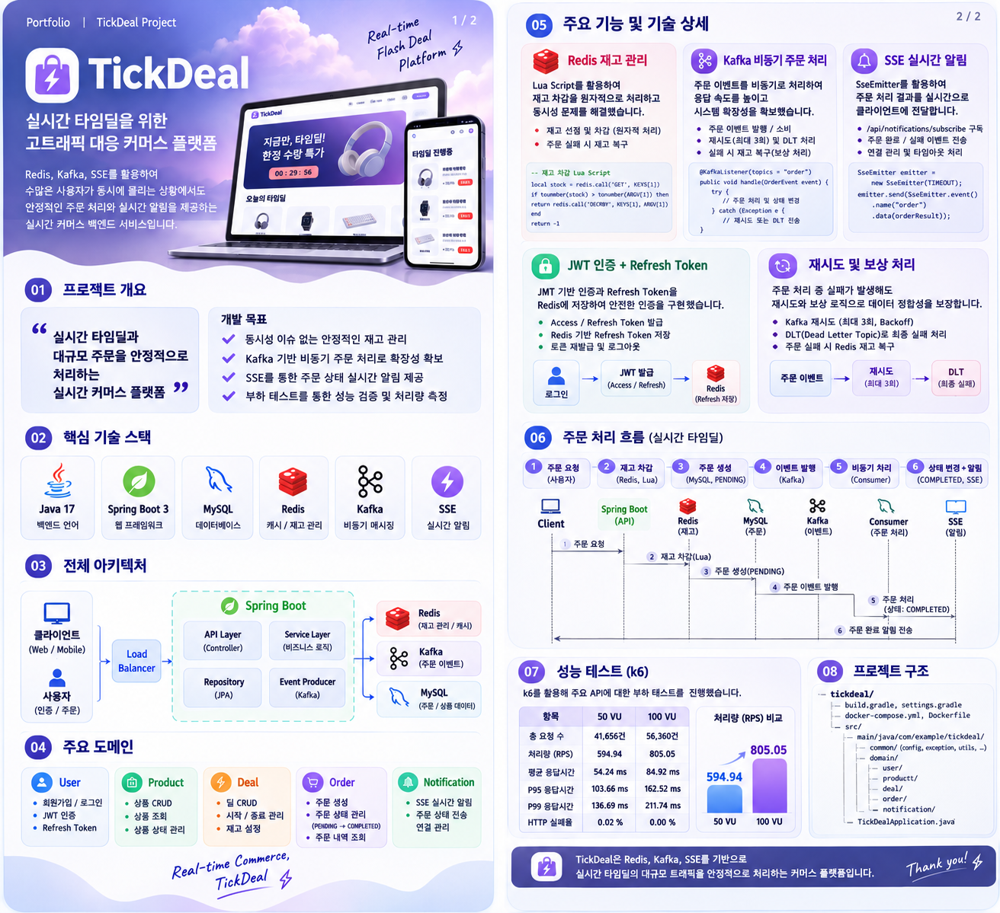
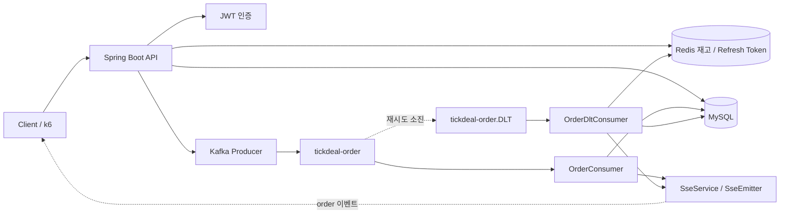
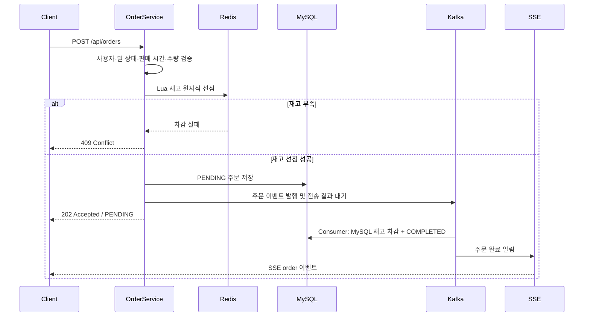
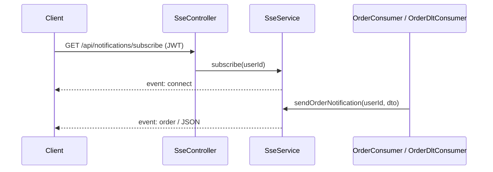

# ⚡ TickDeal

> **한정된 재고, 몰려드는 주문. 단 한 개도 초과 판매하지 않도록.**  
> Redis 원자적 재고 선점부터 Kafka 비동기 주문 처리, SSE 실시간 결과 알림까지 구현한 **Flash Deal 커머스 백엔드**



**🛒 Flash Deal · ⚡ Redis Lua · 📨 Kafka · 📡 SSE · 🔐 JWT · 📊 k6**

Spring Boot 기반의 실시간 타임딜 커머스 서비스

---

## 👀 30초 요약

**TickDeal**은 정해진 시간 동안 제한된 재고의 상품을 판매하는 타임딜 서비스입니다. 단순 주문 CRUD를 넘어 **동시성 / 데이터 정합성 / 비동기 장애 복구 / 실시간 알림 / 성능 검증**을 고민하며 설계했습니다.

| 문제 | 적용한 기술 | 해결 방향 |
|---|---|---|
| ⚡ 동시 구매로 인한 초과 판매 | **Redis + Lua Script** | 재고 확인·차감을 원자적으로 처리 |
| 📨 주문 처리 단계 분리 | **Kafka + JPA** | PENDING 주문 생성 후 이벤트 기반 상태 전이 |
| 🛡️ 메시지 처리 실패 | **Retry + DLT + 재고 보상** | 실패 주문 상태 기록 및 Redis 재고 복구 |
| 📡 비동기 주문 결과 전달 | **SSE / SseEmitter** | 주문 완료·실패를 클라이언트에 이벤트로 전달 |
| 🔐 로그인 상태 관리 | **JWT + Redis Refresh Token** | 액세스 토큰 재발급 및 로그아웃 처리 |
| 📊 대량 요청 성능 검증 | **Grafana k6** | 50/100 VU의 RPS, P95, 오류율 측정 |

---

## ✨ 주요 기능

### 🔐 User / Authentication
- 회원가입 및 로그인, JWT Access / Refresh Token 발급
- Redis 기반 Refresh Token 저장, 토큰 재발급 및 로그아웃

### 📦 Product
- 상품 생성 / 조회 / 수정 / 삭제
- 상품 활성 상태 관리

### ⚡ Deal
- 타임딜 생성 / 조회 / 수정 / 삭제
- 타임딜 가격, 기간, 재고 및 상태 관리
- 타임딜 활성화 API

### 🛒 Order / Inventory
- Redis Lua Script 기반 원자적 재고 선점
- MySQL `PENDING` 주문 생성 → Kafka 이벤트 발행
- Consumer를 통한 `COMPLETED` / `FAILED` 상태 전이
- Kafka 재시도, DLT 및 주문별 멱등 재고 복구
- 사용자 주문 목록 / 상세 / 대기 주문 조회

### 📡 Real-time Notification
- JWT 인증 사용자별 SSE 구독
- `SseEmitter` 연결 관리 및 연결 종료 정리
- 주문 완료 / 실패 시 `order` 이벤트 전송

### 📊 Performance Test
- 100건 동시 요청 재고 정합성 테스트
- 50 VU 및 100 VU 단계별 부하 테스트
- 처리량, 평균 응답시간, P95/P99, 실패율 검증

---

# 🏗️ Architecture



### 주문 처리 순서



> **중요:** 주문 전체가 비동기로 저장되는 구조가 아닙니다. 실제 코드에서는 `PENDING` 주문을 MySQL에 먼저 저장하고 Kafka Consumer가 주문 상태를 `COMPLETED`로 전환합니다. Producer 역시 `send(...).get(10, TimeUnit.SECONDS)`로 Kafka 전송 결과를 기다립니다.

---

# 🎯 기술적으로 고민한 부분

## 1. Redis Lua Script로 재고 경쟁 상태 제어

재고 확인과 차감을 분리하면 동시 요청이 같은 재고를 읽고 초과 판매할 수 있습니다. `InventoryService`는 `stock-decrease.lua`를 Redis에서 실행해 원자적으로 재고를 선점합니다.

- 재고 키: `tickdeal:deal:{dealId}:stock`
- 재고 초기화: `SETNX`에 해당하는 `setIfAbsent` 사용
- 주문 실패 시: `stock-restore.lua`로 재고 보상
- 중복 복구 방지: `tickdeal:order:{orderNumber}:stock-restored` 키를 사용하는 주문별 멱등 복구

**동시성 검증:** 초기 재고 10개에 100건의 동시 주문 요청을 보내 **10건 접수, 90건 재고 부족 거절**을 확인했습니다. 이는 Redis 재고 선점 기준의 결과입니다.

## 2. Kafka 주문 이벤트와 상태 전이

`OrderService`는 Redis 재고 선점 후 `PENDING` 주문을 저장하고 `OrderProducer`를 통해 `tickdeal-order` 토픽으로 이벤트를 발행합니다.

`OrderConsumer`는 `OrderPersistenceService.completeOrder()`를 호출하여 다음 작업을 수행합니다.

1. 주문 행을 `findByOrderNumberForUpdate`로 잠금 조회
2. 이미 `COMPLETED` 또는 `FAILED`인 주문은 중복 처리하지 않음
3. MySQL 재고 차감
4. 주문 상태를 `COMPLETED`로 변경
5. 실제 상태가 변경된 경우에만 SSE 주문 완료 알림 전송

Kafka Producer는 `acks=all`, `enable.idempotence=true`로 구성했습니다. Consumer는 자동 오프셋 커밋을 비활성화하도록 설정했습니다.

## 3. 재시도·DLT·보상 처리

`KafkaConfig`의 `DefaultErrorHandler`는 **1초 간격으로 최대 3회 재시도**하고, 최종 실패 이벤트를 `tickdeal-order.DLT`로 보냅니다.

`OrderDltConsumer`는 이미 완료된 주문을 제외하고 `PENDING → FAILED` 전이를 시도하며, 주문별 1회 Redis 재고 복구를 수행하고 SSE 실패 알림을 전송합니다. Kafka 발행 과정에서 예외가 발생한 경우에도 `OrderService`에서 실패 처리 및 재고 복구를 시도합니다.

> 실패 보상은 코드에 구현되어 있지만, 모든 장애 시나리오에 대해 완전한 정합성이 검증되었다고 단정하지는 않습니다. 예를 들어 DB 커밋과 SSE 발송 시점, 외부 시스템 장애에 대한 추가 테스트가 필요합니다.

## 4. SSE 기반 주문 상태 알림

`SseController`는 인증된 사용자의 이메일로 사용자 ID를 조회하고 `SseService.subscribe(userId)`를 호출합니다.

- **구독 API:** `GET /api/notifications/subscribe`
- **Content-Type:** `text/event-stream`
- **구현체:** Spring MVC `SseEmitter`
- **연결 유지 시간:** 60분 (`SSE_TIMEOUT`)
- **구독 저장:** `ConcurrentHashMap<Long, SseEmitter>`
- **초기 이벤트:** `connect` / `SSE 연결성공`
- **주문 결과 이벤트:** `order` / `OrderNotificationDto`
- **완료 이벤트:** `COMPLETED`, `주문이 완료되었습니다.`
- **실패 이벤트:** `FAILED`, `주문 처리에 실패했습니다. 재고가 복구되었습니다.`



연결 완료·타임아웃·오류 시 Emitter를 Map에서 제거합니다. 같은 사용자가 다시 구독하면 기존 Emitter를 완료하고 새 연결로 교체합니다.

**현재 구현 범위:** SSE 연결이 없는 사용자의 이벤트는 로그를 남기고 전송을 생략합니다. 따라서 **연결이 끊긴 동안의 이벤트를 저장하고 재전송하는 기능은 이 코드에서 확인되지 않습니다.** 또한 Emitter 저장소는 단일 애플리케이션 인스턴스의 메모리 기반입니다.

## 5. JWT Refresh Token 관리

Access/Refresh Token을 발급하며 Refresh Token은 Redis의 `refresh-token:{email}` 키에 만료 시간과 함께 저장합니다. 재발급 및 로그아웃 API가 분리되어 있습니다.

---

## 📊 k6 부하 테스트 — Performance Report

### ⚡ 100 VU · Performance Snapshot

**테스트 대상:** `POST /api/orders` · **환경:** 로컬 Docker Compose · **실행 시간:** 70초

| **최대 가상 사용자** | **HTTP 처리량** | **P95 응답시간** | **HTTP 실패율** |
|:---:|:---:|:---:|:---:|
| **100 VUs** | **805.05 RPS** | **162.52 ms** | **0.00%** |

| 총 요청 수 | 평균 응답시간 | P99 응답시간 | 서버 5xx 오류 |
|:---:|:---:|:---:|:---:|
| **56,360건** | **84.92 ms** | **211.74 ms** | **0건** |

**검증 기준: 모두 통과**  
`P95 < 1,000ms` · `P99 < 2,000ms` · `서버 5xx 오류율 < 1%`

### 📈 50 VU vs 100 VU 성능 비교

| 지표 | 50 VU | **100 VU** | 변화 |
|:---|---:|---:|---:|
| **HTTP 처리량** | 594.94 RPS | **805.05 RPS** | **+35.3%** |
| 평균 응답시간 | 54.24ms | 84.92ms | +30.68ms |
| P95 응답시간 | 103.66ms | 162.52ms | +58.86ms |
| P99 응답시간 | 136.69ms | 211.74ms | +75.05ms |
| 총 HTTP 요청 | 41,656 | **56,360** | +14,704 |
| HTTP 실패 | 11건 | **0건** | 11건 감소 |
| 서버 5xx 오류 | 0건 | 0건 | 동일 |

#### 처리량 비교 (RPS)

```text
50 VU   ██████████████████████████████            594.94
100 VU  ████████████████████████████████████████  805.05
```

#### P95 응답시간 비교 (낮을수록 좋음)

```text
50 VU   █████████████████████████                 103.66 ms
100 VU  ████████████████████████████████████████  162.52 ms
```

> **결과 해석:** 100 VU 부하 테스트에서 평균 **805.05 HTTP 요청/초**를 처리했고, P95 응답시간 **162.52ms**, HTTP 실패율 **0%**를 기록했습니다. 다만 이 수치는 **주문 API 요청 접수 성능**이며 Kafka Consumer의 최종 DB 저장 완료 TPS와는 다릅니다. 50 VU 테스트에서는 요청 타임아웃이 11건 발생했습니다.

### 🧪 재고 동시성 검증

초기 재고 **10개**에 **100건**의 동시 구매 요청을 보내 **10건 접수(202)**, **90건 재고 부족(409)**을 확인했습니다. Redis 원자적 차감으로 재고를 초과하는 주문 접수를 방지했습니다.

### 🧰 테스트 조건 및 실행

- 도구: **Grafana k6**
- 환경: **로컬 Docker Compose (Spring Boot / MySQL / Redis / Kafka)**
- 부하 시나리오: VU 점진 증가 → 30초 유지 → 감소 (총 70초)
- 성능 기준: `p(95)<1000`, `p(99)<2000`, 서버 오류율 `<1%`

```powershell
docker run --rm `
  -e BASE_URL="http://host.docker.internal:8080" `
  -e TOKEN="YOUR_ACCESS_TOKEN" `
  -e DEAL_ID="1" `
  -v "${PWD}/k6:/scripts" `
  grafana/k6 run /scripts/load-test.js
```

> 테스트 전 타임딜 상태, 남은 재고, JWT 유효기간을 확인해야 합니다. 모든 수치는 개발 환경의 단일 실행 결과이며 운영 환경 성능을 보장하지 않습니다.

---

# 🛠️ 기술 스택

| 구분 | 기술 |
|---|---|
| Language / Build | Java 17, Gradle |
| Backend | Spring Boot 4.1.2, Spring Web MVC |
| Security | Spring Security, JWT (JJWT), BCrypt |
| Persistence | Spring Data JPA, MySQL 8 |
| Cache / Inventory | Spring Data Redis, Redis 7, Lua Script |
| Messaging | Spring Kafka, Apache Kafka 4.1.2 |
| Realtime | Server-Sent Events, SseEmitter |
| Testing | Grafana k6, JUnit |
| Infrastructure | Docker, Docker Compose |

> `build.gradle`에 QueryDSL 의존성도 포함되어 있으나, 확인한 핵심 구현 설명에서는 실제 QueryDSL 사용 사례를 별도 성과로 주장하지 않았습니다.

---

# 🗂️ 프로젝트 구조

```text
tickdeal/
├── build.gradle
├── docker-compose.yml
├── Dockerfile
├── setup-and-run.ps1
├── k6/
│   ├── concurrency.js
│   └── load-test.js
└── src/main/
    ├── resources/
    │   ├── application.yml
    │   └── scripts/
    │       ├── stock-decrease.lua
    │       └── stock-restore.lua
    └── java/com/example/tickdeal/
        ├── common/
        │   ├── auth/          # 재발급, 로그아웃, Refresh Token
        │   ├── config/        # Security, Redis, Kafka, JPA
        │   ├── filter/        # JwtFilter
        │   ├── exception/     # 전역 예외 처리
        │   └── utils/         # JwtUtil
        └── domain/
            ├── user/          # 회원
            ├── product/       # 상품
            ├── deal/          # 타임딜
            ├── inventory/     # Redis 재고
            ├── order/         # 주문, Producer/Consumer/DLT
            └── notification/  # SseController, SseService
```

---

## 📡 API 목록

아래 목록은 업로드된 Controller의 Mapping을 기준으로 정리했습니다.

| Method | Endpoint | Controller |
|---|---|---|
| `POST` | `/api/auth/reissue` | Auth |
| `POST` | `/api/auth/logout` | Auth |
| `POST` | `/api/deals/{id}` | Deal |
| `POST` | `/api/deals` | Deal |
| `GET` | `/api/deals/{id}` | Deal |
| `GET` | `/api/deals` | Deal |
| `PATCH` | `/api/deals/{id}` | Deal |
| `DELETE` | `/api/deals/{id}` | Deal |
| `GET` | `/api/inventory/{dealId}` | Inventory |
| `GET` | `/api/notifications/subscribe` | Sse |
| `POST` | `/api/orders` | Order |
| `GET` | `/api/orders/{orderNumber}` | Order |
| `GET` | `/api/orders` | Order |
| `GET` | `/api/orders/pending` | Order |
| `POST` | `/api/products` | Product |
| `GET` | `/api/products/{productId}` | Product |
| `GET` | `/api/products` | Product |
| `PATCH` | `/api/products/{productId}` | Product |
| `DELETE` | `/api/products/{productId}` | Product |
| `POST` | `/api/users/register` | User |
| `POST` | `/api/users/login` | User |
| `GET` | `/api/users/{id}` | User |
| `PATCH` | `/api/users/{id}` | User |
| `DELETE` | `/api/users/{id}` | User |

### 주문 요청 예시

```http
POST /api/orders
Authorization: Bearer {ACCESS_TOKEN}
Content-Type: application/json
```

```json
{"dealId":1,"quantity":1}
```

주문 접수 응답은 `202 Accepted`이며 주문 상태는 `PENDING`입니다. 주문 결과는 주문 조회 API 또는 SSE `order` 이벤트로 확인할 수 있습니다.

---

## 🐳 로컬 실행

```powershell
docker compose up -d --build
docker compose ps
```

| 서비스 | Compose 서비스명 | 호스트 포트 |
|---|---|---:|
| Spring Boot | `spring` | 8080 |
| MySQL | `mysql` | 3307 |
| Redis | `redis` | 6379 |
| Kafka | `kafka` | 9092 |

MySQL 데이터베이스는 `nbcam`이며, Kafka 컨테이너 내부 연결은 `kafka:9093`으로 구성되어 있습니다.

**재고 확인:**

```powershell
docker compose exec mysql mysql -u root -p nbcam -e "SELECT id, stock, status FROM deals;"
docker compose exec redis redis-cli GET tickdeal:deal:1:stock
```

---

## 👨‍💻 Developer

**이재환** · [GitHub](https://github.com/0xc0de1dea) · [Tech Blog](https://urgenius.tistory.com/)